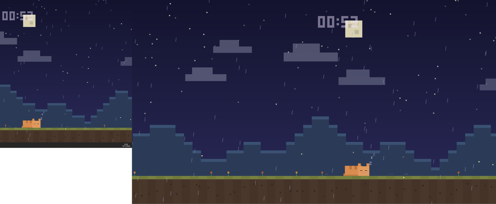
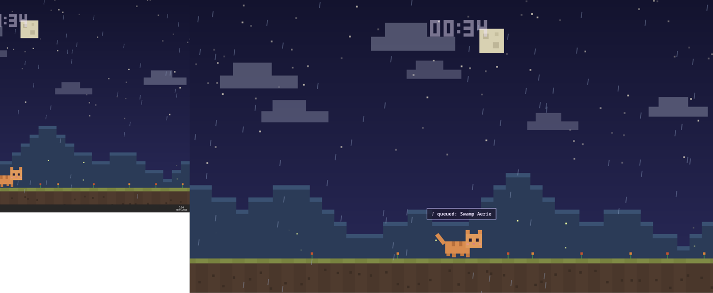

# Cozy Blocks

An animated pixel-art wallpaper for KDE Plasma 6, plus a calm koi-pond lock screen.
Everything is plain QML rectangles. There are no images, and it is OLED burn-in safe.



## What is in it

**Cozy Blocks** (desktop wallpaper, `com.fishyshu.cozyblocks`)
- A little orange cat walks across blocky hills. It sits, grooms, stretches and naps at night (with a breathing loaf and z's).
- The sky follows your real clock: a sun by day, a moon and shooting stars by night, and fireflies.
- Seasons change the grass and flowers. Random weather: rain, snow, autumn leaves, spring petals.
- A rare sky fish (night) or butterfly (day) swims by, and the cat chases it.
- A pixel clock drifts around the sky.
- The Minecraft soundtrack plays with game-style gaps, and a bubble shows the song name.
  - The music fades out when another app plays sound or anything is fullscreen.
- OLED safe: the whole scene slowly pixel-shifts, the horizon breathes, nothing stays still,
  and animation stops on a screen with a fullscreen window. It renders at 30 fps, at about 10 % of one core.

**Koi Pond** (lock screen, `com.fishyshu.koipond`)
- Koi glide under lily pads and lotuses, with ripples, a wobbling moon reflection and fireflies. No clock (KDE draws one).



## Install

Requirements: KDE Plasma 6 (Wayland), `jq`, and Minecraft installed once through a launcher (for the music).

```sh
git clone git@github.com:FishyShu/cozy-blocks.git
cd cozy-blocks
./install.sh
```

`install.sh` does these steps:
1. Symlinks both plugins into `~/.local/share/plasma/wallpapers` (a `git pull` updates them).
2. Adds `cozy` to `~/.local/bin` and the hotkeys.
3. Copies the music.
4. Sets the wallpaper and the lock screen.

Log out and back in once for the hotkeys. To skip the music, use `NO_MUSIC=1 ./install.sh`.

### Music

The soundtrack belongs to Mojang, so this repo does not include it.
`tools/fetch-music.sh [assets-dir]` copies it from your own launcher
(`~/.minecraft`, Prism, ATLauncher and MultiMC are found automatically) into `~/Music/minecraft`.
Launch a recent Minecraft version once so the launcher downloads the newest tracks.

## Controls

| Hotkey | Command | Does |
|---|---|---|
| Meta+Alt+N | `cozy next` | next song |
| Meta+Alt+M | `cozy mute` | mute / unmute |
| Meta+Alt+C | `cozy pet` | pet the cat (heart + hop) |
| | `cozy rain\|snow\|leaves\|petals\|clear` | force the weather |

Volume and music on/off are set per screen: right-click the desktop, then **Configure Desktop and Wallpaper**.
Clicking the cat does not work, because the folder-view desktop takes all clicks.

## Tests

```sh
node logic.test.js
```

## Uninstall

```sh
qdbus6 org.kde.plasmashell /PlasmaShell org.kde.PlasmaShell.evaluateScript \
  'desktops().forEach(d=>{d.wallpaperPlugin="org.kde.image"})'
kwriteconfig6 --file kscreenlockerrc --group Greeter --key WallpaperPlugin --delete
rm ~/.local/bin/cozy ~/.local/share/applications/cozy-*.desktop
rm ~/.local/share/plasma/wallpapers/com.fishyshu.{cozyblocks,koipond}   # the symlinks
# hotkeys: restore ~/.config/kglobalshortcutsrc.bak-cozy, or delete the [services][cozy-*] groups
```

After a QML edit, run `systemctl --user restart plasma-plasmashell` to reload (Plasma caches components).
